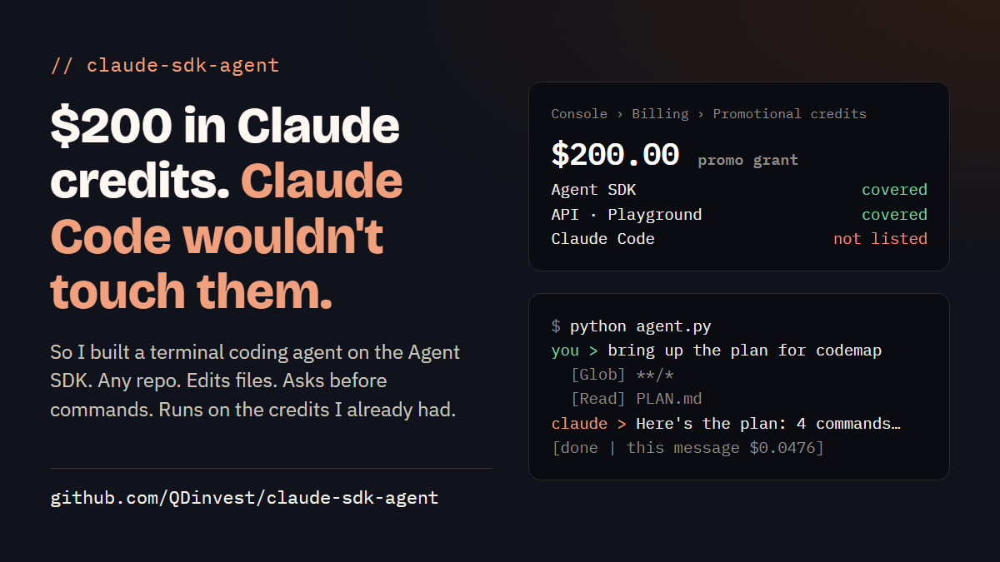

# claude-sdk-agent



A coding agent you run in your terminal. Point it at any folder or repo and chat with it: it reads your code, edits and creates files, asks before running commands, and remembers the conversation for each folder.

It's built on Anthropic's [Claude Agent SDK](https://pypi.org/project/claude-agent-sdk/) and bills to your **Anthropic API key**. So it runs on API credits, including promotional credits whose grant lists the **Agent SDK**. Some promo grants don't cover Claude Code itself, and this gives you a way to use those credits.

> **Tested in November 2026:** usage came out of a promotional grant whose "Applies to" list included the Agent SDK, while Claude Code could not use that grant. Grants differ, so [check yours](#5-check-which-credits-it-used) before a long session.

## What a session looks like

The first two messages below are from a real run (the long reply is shortened). The third shows how a permission prompt looks.

```text
PS C:\Users\you\codemap> python $HOME\claude-sdk-agent\skills\sdk-agent\scripts\agent.py
Folder: C:\Users\you\codemap
Model: claude-sonnet-5-5 | new chat | type 'exit' to quit

you > hi

claude > Hi. What do you want to work on in `codemap`?

[done | this message $0.0774 | total this run $0.0774]

you > can you bring up the plan for building this codemap
  [Glob] **/*
  [Read] C:\Users\you\codemap\PLAN.md

claude > Status: nothing is built yet. The only file in `codemap` is `PLAN.md`.

The plan:
1. No installs: one Python stdlib script, `scripts/codemap.py`.
2. Session-start hook that points the agent to `.codemap/MAP.md`.
3. Four agent commands: find, file, map, build.
...

[done | this message $0.0476 | total this run $0.1250]

you > check that python works here
  Allow Bash: python --version
  [y = yes, a = always allow Bash this run, N = no] > y
  [Bash] python --version

claude > Python 3.11.9 is installed, so the script will run here.

[done | this message $0.0312 | total this run $0.1562]

you > exit
```

- Lines in `[brackets]` are what the agent is doing: reading, searching, writing.
- `Allow ...` is the agent asking first. Type `y` to allow, `a` to stop asking about that kind of action for this run, or press Enter to refuse.
- After each reply you see what that message cost and the total since you started.
- In a real terminal it's in color: your prompt green, Claude orange, tool steps dimmed, permission prompts yellow.

## Setup, step by step

You need Python 3.10 or newer and an Anthropic API key. It takes about 5 minutes.

### 1. Check Python

```bash
python --version
```

You should see `Python 3.10` or higher. If you get "not found", install Python from [python.org](https://www.python.org/downloads/). On Windows, tick **"Add python.exe to PATH"** in the installer, then open a new terminal.

### 2. Download this repo and install the one dependency

With git:

```bash
cd ~
git clone https://github.com/QDinvest/claude-sdk-agent
python -m pip install -r claude-sdk-agent/requirements.txt
```

Without git: click the green **Code** button on this page, then **Download ZIP**. Unzip it into your home folder as `claude-sdk-agent`, then run the `pip install` line above from your home folder.

### 3. Set your API key

Create a key in the [Claude Console](https://console.anthropic.com) under **API Keys**, then tell your terminal about it:

```powershell
# Windows PowerShell (this window only)
$env:ANTHROPIC_API_KEY = "your-key"
```

```bash
# macOS / Linux (this terminal only)
export ANTHROPIC_API_KEY="your-key"
```

That lasts until you close the window. To set it once for good on Windows, run `setx ANTHROPIC_API_KEY "your-key"` and open a new window. On macOS/Linux, add the `export` line to `~/.zshrc` or `~/.bashrc`.

Keep the key private. Don't paste it into chats, commits or screenshots.

### 4. Start it in the folder you want to work on

Go to your project, then start the agent:

```powershell
# Windows PowerShell
cd C:\path\to\your\project
python $HOME\claude-sdk-agent\skills\sdk-agent\scripts\agent.py
```

```bash
# macOS / Linux
cd ~/path/to/your/project
python ~/claude-sdk-agent/skills/sdk-agent/scripts/agent.py
```

At the `you >` prompt, type what you want in plain English, for example `explain how this project is organized` or `add a test for the login function`. Type `exit` to quit.

Run the same command in the same folder later and it **continues that chat**.

### 5. Check which credits it used

Do this once before a long session:

1. Open the Billing page in the Claude Console and note your **purchased** and **promotional** balances.
2. Send the agent one short message, like `say hi in one line`.
3. Refresh the Billing page and see which balance went down.

If your purchased balance went down, your promo grant doesn't cover the Agent SDK, and this tool will spend paid credit.

## Options

Options go on the start command, not inside the chat. Typing `--budget 10` into a message does nothing.

Inside the chat you can type:

| Command | What it does |
|---|---|
| `/model claude-opus-5-5` | Switch model without restarting |
| `/budget 5` | Change the per-message spending cap. Reconnects to the same chat |
| `/yes` | Turn auto-approve on or off |
| `exit` | Quit (the chat is saved) |

| Option | What it does | Default |
|---|---|---|
| `--dir <folder>` | Work in that folder instead of the current one | current folder |
| `--new` | Start a fresh chat in this folder | continue the last chat |
| `--model <id>` | Choose the model, e.g. `claude-opus-5-5` | `claude-sonnet-5-5` |
| `--budget <usd>` | Spending cap for each message | `2.00` |
| `--yes` | Approve every action without asking. Use with care | off (asks) |

Example:

```bash
python ~/claude-sdk-agent/skills/sdk-agent/scripts/agent.py --model claude-opus-5-5 --budget 5
```

## What it can and can't do on its own

- **File edits** inside the working folder happen **without asking**. Use it in a git repo, or commit first, so you can review and undo changes.
- **Everything else** (running commands, web access) asks first. Answer `y` to allow once, `a` to always allow that kind of action for the rest of this run, or press Enter to refuse.
- **`--yes`** skips every question. Commands then run unchecked, including deletes and commands in other folders, so only use it in a repo you've committed and can restore.
- **Costs** print after every reply. The `--budget` cap stops one runaway message, not a long session.
- **Chats** are saved per folder in `~/.claude-agent-sessions.json`.
- Set `NO_COLOR=1` to turn off color.

## Troubleshooting

| You see | What to do |
|---|---|
| `ANTHROPIC_API_KEY is not set in this window` | Do step 3 in this window. Keys set with `$env:` or `export` only last for that window. |
| `python` is not recognized | Install Python (step 1), or try `py` instead of `python` on Windows. |
| `No module named claude_agent_sdk` | Run the `pip install` line from step 2. |
| Credit balance too low | Your key's credits don't cover this. Check step 5 and your grant's "Applies to" list. |
| It doesn't remember the last chat | Start it from the same folder as before. To start over on purpose, use `--new`. |

## Use it as a Claude skill

`skills/sdk-agent/` is also a Claude skill. Copy that folder into `~/.claude/skills/`, and Claude can install, start and troubleshoot the agent for you when you ask.

## Share page

[`docs/index.html`](docs/index.html) is a one-page explainer with the share card above and copy buttons for each setup step. Open it in a browser, or turn on GitHub Pages for the `docs` folder to host it.

## License

MIT. A community tool built on Anthropic's public Agent SDK; not affiliated with Anthropic.
